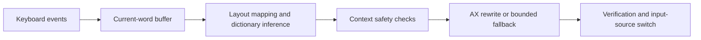

# TypeSwitch

[](https://github.com/ywdagency/typeswitch/actions/workflows/ci.yml)

A native macOS menu bar utility that corrects words typed with the wrong keyboard layout. Built with Swift 6, SwiftUI, AppKit, CoreGraphics, and Accessibility APIs, with all text processing on the Mac.

> [!WARNING]
> Experimental developer preview. Automated tests cover the core logic and simulated text controls; the manual cross-app compatibility matrix is incomplete. Do not rely on it for important text. A signed, notarized release candidate is being tested as a private draft; no binary release has been published yet.

## Installation

The release workflow prepares signed DMGs for [GitHub Releases](https://github.com/ywdagency/typeswitch/releases), with a universal app for Apple silicon and Intel Macs running macOS 15 or newer. The 0.1.0 release candidate passed Developer ID signing, Apple notarization, and Gatekeeper checks and remains an unpublished draft. Until publication, use the local source build below. Installation from a release DMG is dragging TypeSwitch into Applications and granting Input Monitoring and Accessibility. See [installation notes](docs/installation.md) and the [release preparation workflow](docs/distribution.md).

## What it does

When a dictionary-backed word such as `ghbdtn` is typed with the US English layout, TypeSwitch can replace it with `привет` and switch the input source. It supports English, Russian, and Ukrainian layouts, refuses ambiguous candidates, and lets the user pause correction or ignore individual apps.

Russian recognition includes inflected forms validated by bundled Hunspell rules, such as `rjgbhjdfybtv` → `копированием`, even when that form is absent from the flat word list.

The menu bar app includes language settings, a configurable pause/resume shortcut, local learned corrections, and immediate Esc undo for the most recent correction. Esc restores the original word and input source while preserving the delimiter. A successful Esc undo immediately saves a permanent exception for that exact spelling in its original layout, without an additional prompt. Exceptions stay on this Mac and can be removed in Settings → Exceptions.

One curated dictionary protects known uppercase abbreviations in their source language and recognizes them on the wrong layout. For example, Russian `ГЫИ`, `ЫВ`, and `ЫВШ` become `USB`, `SD`, and `SDI`; Ukrainian `ГІИ`, `ІВ`, and `ІВШ` produce the same results. Recognition requires uppercase input consistent with the reported source layout, a valid abbreviation target, and no competing dictionary target or valid source word. Capitalization alone does not prevent correction: `LFKMIT` still becomes `ДАЛЬШЕ`. Unlisted abbreviations can be added as local exceptions, which match both the layout and letter case.

## Engineering focus

The implementation separates keyboard-event delivery, physical layout mapping, dictionary inference, context safety, and text replacement. A monotonic input sequence prevents delayed corrections from acting on stale typing. Rewrites must pass checks for secure input, password fields, terminal contexts, writable controls, and a known target token.

Accessibility is the primary replacement path. Some browser controls expose misleading Accessibility text models, so the current implementation also contains a bounded physical-key fallback after context checks. That fallback and real-app compatibility remain an explicit part of the experimental boundary.



Read the [architecture](docs/architecture.md), [privacy model](docs/privacy.md), and [observed compatibility status](docs/compatibility.md). The repository includes a separate native test host with editable, secure, and read-only controls.

## Build and test

Requires macOS 15 or newer and a Swift 6 toolchain with macOS SDK support, such as Xcode command line tools. There are no third-party Swift package dependencies or API keys to configure.

```sh
git clone https://github.com/ywdagency/typeswitch.git
cd typeswitch
swift build
swift test
python3 -m unittest discover -s scripts/tests
```

Local verification passed 175 Swift tests and 12 Python tooling tests (3 dictionary-generator and 9 packaging checks) on 2026-10-13. Test success does not establish cross-app compatibility; the [manual matrix](docs/compatibility.md) records that separately. GitHub Actions checks builds, tests, and a universal preview DMG on macOS for pushes and pull requests. Python 3 is needed only for development and release tooling; the app has no Python runtime dependency.

For a locally built app bundle that macOS can list in Privacy & Security:

```sh
./scripts/build-dev-app.sh
open ~/Applications/TypeSwitch.app
```

The script installs a development build to `~/Applications/TypeSwitch.app`, replacing a previous development copy at that path. It uses a local Apple Development signing identity when available and ad-hoc signing otherwise. It does not notarize or upload the app.

Grant Input Monitoring and Accessibility only if you intend to test the utility. Settings → General has a separate `Enable…` action for each missing permission; each requests access and opens the corresponding macOS page. The menu exposes the same actions. If TypeSwitch is absent from a permission list, use `Show TypeSwitch in Finder`, then add that app with `+` in System Settings. Permission status refreshes when you return to TypeSwitch. `Control+Option+Space` is the default pause/resume shortcut. See [testing](docs/testing.md) for the controlled test host and refusal checks.

## Privacy and limitations

The app has no network client, telemetry, cloud account, or runtime dictionary download. It keeps a short current-word buffer in memory. Confirmed learned words, exceptions, and settings stay in local UserDefaults; optional local diagnostics contain redacted decision and control metadata. The dictionary regeneration script downloads public upstream data only when a developer explicitly runs it.

The project does not claim universal editor support. Secure fields, terminal-like contexts, ignored apps, stale input, and ambiguous words are refused. Manual testing of permission behavior, browser fields, and caret preservation is still in progress. See [security reporting](SECURITY.md) for reporting a possible data exposure.

## Contributing and reporting issues

See [CONTRIBUTING.md](CONTRIBUTING.md) for development checks, dictionary changes, and compatibility reports. Use the [issue templates](https://github.com/ywdagency/typeswitch/issues/new/choose) with synthetic example text. Report possible privacy or security defects through [private vulnerability reporting](https://github.com/ywdagency/typeswitch/security/advisories/new), following [SECURITY.md](SECURITY.md). Recent changes are recorded in the [changelog](CHANGELOG.md).

## Author and licensing

Created by Dmitry Vyshniak. TypeSwitch source code is under the [MIT License](LICENSE). Bundled dictionary data has separate upstream terms, including CC BY-SA 4.0 and GPL-3.0 for Ukrainian Hunspell material. The MIT License does not relicense those data files. Complete copied notices, source links, and transformation details are in [third-party notices](docs/third-party-notices.md) and [LICENSES](LICENSES/).
